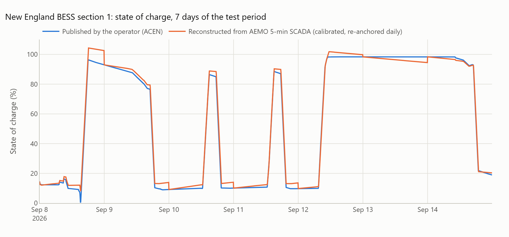
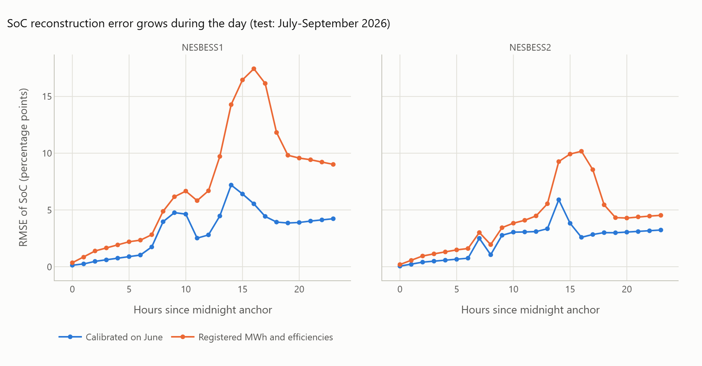
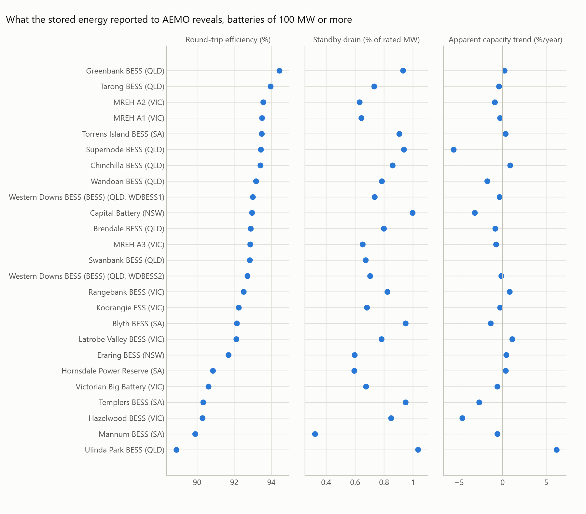
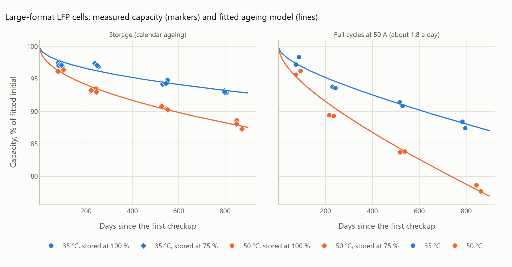
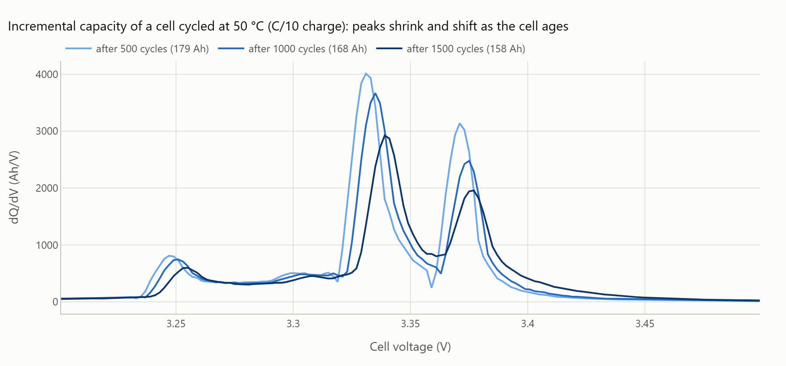
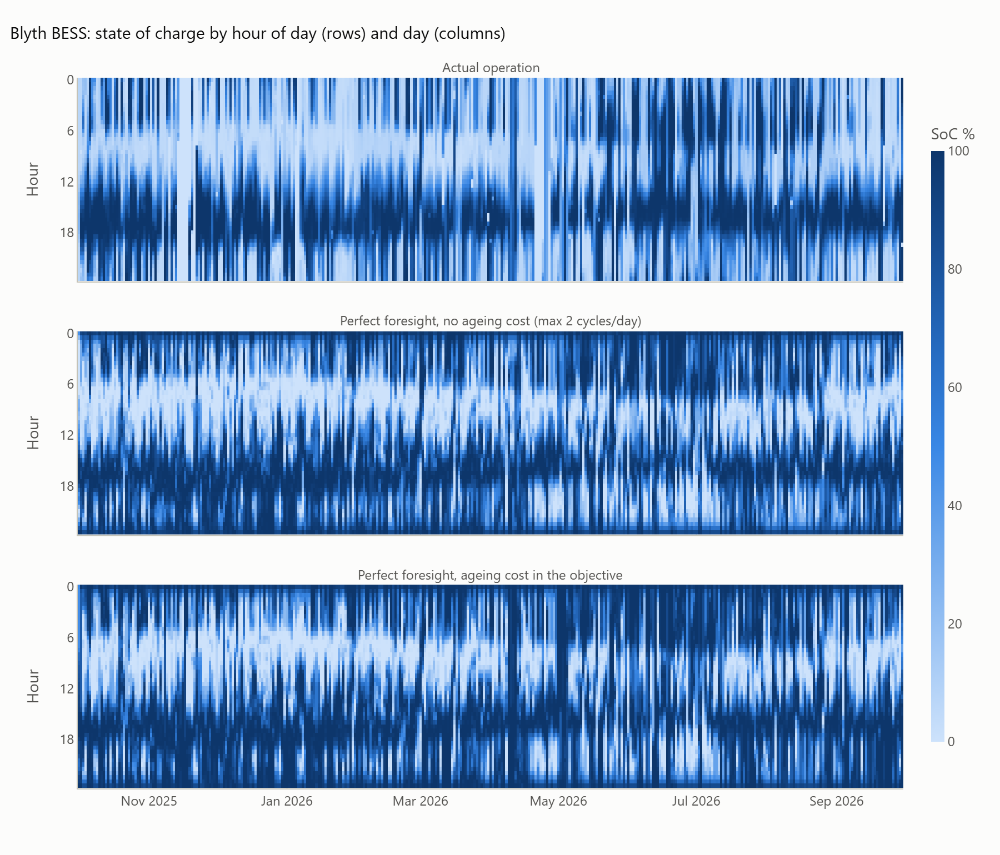
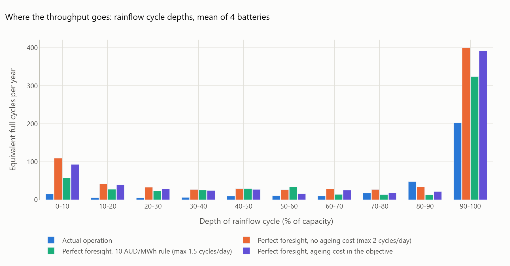
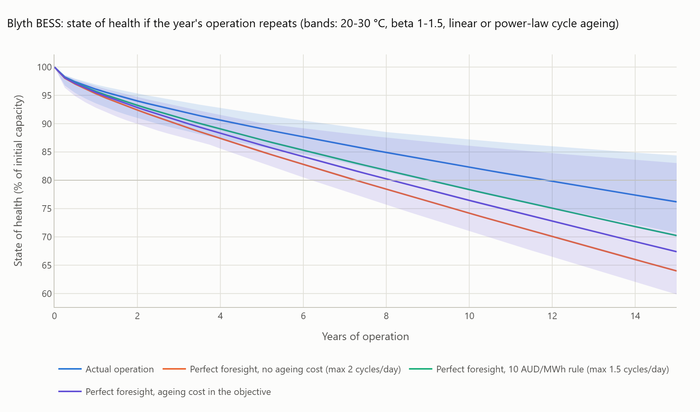
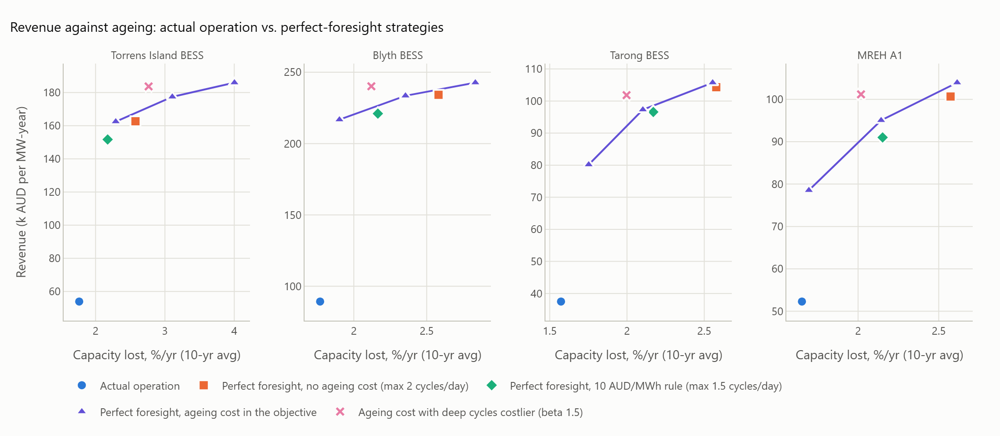

# State of charge, state of health and operating strategy of grid batteries

[](https://github.com/kwwaleszczynski-del/bess-soc-soh-degradation/actions/workflows/ci.yml)

How much of a grid battery's life does a trading strategy use up, and what does it earn for it? Market data show
what a battery did (5-minute power and prices), but not what that did to the cells. This project closes the gap
with three pieces of open data:

1. **State of charge (SoC) from market data, validated.** The SoC of a battery is reconstructed from AEMO's
   5-minute SCADA and checked against the SoC its operator publishes (ACEN's New England BESS, NSW).
2. **State of health (SoH) from cell data.** Capacity fade of twelve large-format (180 Ah) stationary-storage LFP
   cells, aged for 807-875 days in the lab (Yagci et al. 2025), gives the parameters of a semi-empirical ageing model:
   calendar ageing driven by time, temperature and SoC, cycle ageing counted with the rainflow method.
3. **Strategy.** For four batteries in Australia's National Electricity Market (NEM), one year of actual operation
   is compared with perfect-foresight arbitrage with and without the cost of ageing in the objective: revenue,
   cycle depths, capacity lost per year, years to 80 % SoH and revenue per 1 % of capacity lost.

## Key results

**1. SoC from 5-minute market data tracks the operator's SoC to 2.7-3.8 percentage points (RMSE) within a day.**
Calibrated on June 2026 and tested on July-September (New England BESS, 2 x 100 MW):

| Section | Model | RMSE, daily anchor | 95th pct. error at end of day | Drift without anchor |
|---|---|---|---|---|
| 1 | registered (200 MWh, 90 % / 90 %) | 9.0 pp | 22.8 pp | 1.8 pp/day |
| 1 | calibrated (262 MWh, RTE 0.88, 0.42 MW standby) | **3.8 pp** | 8.4 pp | 2.2 pp/day |
| 2 | registered | 5.0 pp | 9.8 pp | 1.9 pp/day |
| 2 | calibrated (260 MWh, RTE 0.88, 0.22 MW standby) | **2.7 pp** | 7.3 pp | 2.3 pp/day |

- The operator's 0-100 % corresponds to about **250-260 MWh** at the connection point, against 200 MWh registered
  with AEMO: the battery has room beyond its registered energy (DC overbuild). The June calibration gives 262 MWh
  (section 2); fitted month by month the value moves between 227 and 263 MWh (both sections, both power inputs,
  `results/soc_monthly_calibration.csv`), and one fit over the whole ACEN record in the companion project
  [bess-ops-warranty](https://github.com/kwwaleszczynski-del/bess-ops-warranty) gives 251-252 MWh. Market data pin
  the usable energy down to roughly 10 %, not to the MWh.
- Integrated without an anchor the SoC drifts by about 2 pp a day: the auxiliary load changes with the season
  (monthly fits: 0.4 to 0.8 MW) and the battery management system resets its SoC (11 and 6 jumps of up to 56 pp).
- The stored energy NESBESS1 reported to AEMO ran **opposite** to its SoC until 5 August 2026 (it reported the
  headroom, `~ 200 MWh - SoC x 2 MWh/%`) and correctly from 6 August.




**2. Across the fleet, reported SoC gives efficiency and standby losses, not SoH.** For the 100 MW+ batteries with
consistent monthly fits in at least eight months (25 batteries), round-trip efficiency at the connection point is
0.89-0.94 and the standby drain 0.3-1.0 % of rated power. The "apparent capacity" trend is within +-1 %/year for 16
of 24 batteries, below the 2-4 %/year the ageing model predicts for a battery's first two years: the reported
energy follows the BMS's usable window, so fade stays largely invisible in market data.



**3. Cell data: calendar ageing dominates at grid duty.** Fitted on the 180 Ah LFP cells (capacity RMSE 0.5 % for
storage, 0.7 % for cycled cells):
calendar `k_cal` 1.6e-3 per sqrt(day) at 25 degC, activation energy 30 +- 6 kJ/mol, no measurable effect of
storage SoC between 75 % and 100 %; cycle ageing 2.1 % per 1000 equivalent full cycles at 25 degC (Ea 32 +- 10 kJ/mol).
At 25 degC that is 3.1 % calendar loss in year one and 9.9 % after ten years. A ridge regression on four
incremental-capacity features of an ordinary 50 A charge predicts capacity with **0.86 % mean absolute error**
(leave-one-cell-out; baseline 3.2 %).




**4. Strategy: revenue vs. capacity lost** (Oct 2025 - Sep 2026, 25 degC; revenue in k AUD per MW-year, loss =
10-year average, % of capacity per year):

| Battery | Actual (energy + FCAS) | PF, no ageing cost, <= 2 cycles | PF, 10 AUD/MWh rule | PF, ageing cost (250 AUD/kWh) |
|---|---|---|---|---|
| Torrens Island (SA, 1 h) | 54, 0.87 cyc/day, 1.76 %/yr | 163, 2.00, 2.58 | 152, 1.50, 2.17 | 177, 2.67, 3.11 |
| Blyth (SA, 2 h) | 89, 0.88, 1.77 | 234, 2.00, 2.58 | 221, 1.48, 2.17 | 234, 1.72, 2.35 |
| Tarong (QLD, 2 h) | 37, 0.68, 1.57 | 104, 2.00, 2.58 | 97, 1.49, 2.17 | 97, 1.40, 2.10 |
| MREH A1 (VIC, 2 h) | 52, 0.82, 1.65 | 101, 2.00, 2.57 | 91, 1.47, 2.15 | 95, 1.46, 2.14 |

- Calendar ageing (9.9 % in ten years at 25 degC, about 1 %/yr on average) is the floor every strategy pays;
  cycling adds 0.6-0.8 %/yr in actual operation and 1.1-2.1 %/yr in the perfect-foresight strategies of the
  table. Actual operation uses the least life per year (12-14 years to 80 % SoH) but also earns the least per 1 %
  of capacity lost, battery by battery and although its revenue includes FCAS (4-7 % of it), which the energy-only
  strategies do not have: Torrens Island 7.6 M AUD against 11.6-17.7 M AUD for the perfect-foresight strategies,
  Blyth 10.1 against 17.1-22.8, Tarong 7.1 against 12.1-15.3, MREH A1 6.3 against 7.8-10.0. The ratio counts
  calendar ageing, which every strategy pays (9.9 % of the 15.7-17.7 % lost in ten years of actual operation), so it
  rewards throughput: the more a battery cycles, the more revenue shares the same calendar loss.
- An ageing cost derived from the cell fit (27 AUD per MWh discharged at 250 AUD/kWh) instead of a cycle cap lets
  the battery cycle when spreads are large (Torrens Island: 2.7 cycles a day) and skip small ones. At the same
  capacity loss (interpolated along the 125/250/500 AUD/kWh points) it earns 1-6 % more than the 10 AUD/MWh rule.
- If deep cycles cost more per MWh than shallow ones (`beta = 1.5`, optimised and evaluated with that model), the
  optimiser cycles more often but less deeply: 3-7 % more revenue for 5-11 % less modelled capacity loss than the
  `beta = 1` strategy. How much a real LFP pack rewards shallow cycling is the largest open question of this model
  (see Limitations).






The interactive version of the charts is `docs/dashboard.html` (the chart with ACEN's own SoC series is an image
only, as those data are not redistributed); all numbers are in `results/`.

## Method

### 1. SoC from metered power

AEMO's `DISPATCH_UNIT_SCADA` gives an instantaneous MW reading at the start of every 5-minute interval (positive:
discharging). The energy of an interval is the integral of the straight line between two readings, split exactly
into its charging part `C_k` and discharging part `D_k`. The SoC (fraction of usable energy `E`) then follows

```
SoC_{k+1} = SoC_k + (eta_c * C_k - D_k / eta_d - P_sb * dt) / E
```

with one-way efficiencies `eta_c`, `eta_d` and a constant standby drain `P_sb` (auxiliaries such as HVAC, and
self-discharge). Over any window `w` the change of SoC is linear in the window's energy and duration:

```
dSoC_w = a * C_w - b * D_w - c * H_w,     a = eta_c / E,   b = 1 / (eta_d * E),   c = P_sb / E
```

`a`, `b` and `c` are estimated by least squares on hourly windows (iteratively dropping windows more than six robust
standard deviations off, which removes the jumps when the battery management system recalibrates its SoC). Without
further assumptions this gives the round-trip efficiency `RTE = a / b = eta_c * eta_d` and the standby drain; with a
symmetric split `eta_c = eta_d` it also gives the usable energy `E = 1 / sqrt(a * b)`.

**Validation.** Calibrated on June 2026, tested on July-September (section 2: July-August, it idled in September):

- *daily anchor:* the reconstruction restarts every midnight from the published SoC, as a model fed with the
  operator's daily SoC would; error by hour since the anchor;
- *open loop:* integrated over the whole test period without any anchor (drift);
- inputs: AEMO SCADA (what anyone can download) and ACEN's own interval-average power;
- models: calibrated vs. the registration (AEMO's `MAXSTORAGECAPACITY` and storage efficiency factors).

**Fleet.** The same regression against `DISPATCHLOAD.INITIAL_ENERGY_STORAGE` (the stored energy every battery
reports to AEMO) is run month by month for every battery of 100 MW or more. A month counts as consistent when the
regression explains at least 99 % of the hourly changes.

### 2. Ageing model

Capacity loss (fraction of initial capacity) is the sum of calendar and cycle ageing:

```
Q_cal(t) = k_cal * A(T, Ea_cal) * exp(gamma * (SoC - 0.5)) * t^0.5            t in days
Q_cyc    = k_cyc * A(T, Ea_cyc) * N_eq,     N_eq = sum_i n_i * DoD_i^beta      rainflow cycles i
A(T, Ea) = exp(-Ea / R * (1/T - 1/T_ref)),  T_ref = 25 degC
```

`n_i` is 1 for a full and 0.5 for a half rainflow cycle of depth `DoD_i` (ASTM E1049 three-point method).
`beta = 1` makes cycle ageing depend only on throughput; `beta > 1` makes deep cycles costlier per MWh than shallow
ones, as in the cycle-life curves of cell data sheets. When the SoC and temperature change, the calendar term is
accumulated in "virtual time", which is exact for a power law: `Q_cal^2` grows at the rate `k^2`, so over a profile
`Q_cal(t) = sqrt(sum_i k_i^2 dt_i)`. This is the structure of Schmalstieg et al. (J. Power Sources 257, 2014) and
Naumann et al. (J. Energy Storage 17, 2018; J. Power Sources 451, 2020) with the rainflow cycle stress of Xu et al.
(IEEE Trans. Smart Grid 9, 2018).

**Parameters from cell data.** Yagci et al. (J. Energy Storage 124, 2025) aged twelve commercial 180 Ah LFP cells
for stationary storage: four by full cycles (2.5-3.65 V, 50 A) in 35 and 50 degC chambers (the cells ran at 36 and
51.5 degC), eight by storage at 75 % and 100 % SoC at 35 and 50 degC, with checkups at room temperature after the
equivalent of 100, 500, 1000 and 1500 cycles.

- *Capacity (coulomb counting).* Each checkup charges and discharges the cell between 2.5 V and 3.65 V at 50 A
  (C/3.6) several times; the capacity is the integral of the current over the last two full constant-current
  discharges. The values after 1500 cycles agree with the authors' per-cycle analysis within 1.5 Ah; the published
  summary sheet repeats the 1000-cycle values under the 1500-cycle heading, so the raw files were used throughout.
- *Fit.* Calendar parameters (`k_cal`, `Ea_cal`, `gamma`) on the eight storage cells, then cycle parameters
  (`k_cyc`, `Ea_cyc`) on the four cycled cells after subtracting the calendar ageing the first fit predicts for them
  (averaged over SoC 0-100 %, as full cycles spend equal time at every SoC). Every cell gets its own initial
  capacity; the formation checkup (another cycler, unknown temperature) is not used as the reference.
- *Incremental capacity analysis (ICA).* `dQ/dV` of the C/10 and C/3.6 charges on a 2 mV grid
  (Savitzky-Golay smoothed). A ridge regression from four features of the 50 A charge curve (charge accumulated in
  3.30-3.36 V and 3.36-3.42 V, height and position of the main peak) predicts the capacity, validated
  leave-one-cell-out.

`beta` cannot be identified from these cells (all cycled at full depth); it is set to 1 and varied up to 1.5.

### 3. Strategies

Each day (288 five-minute prices, NEM time) is optimised with perfect foresight as a linear program (HiGHS via
SciPy) and the days are chained: each starts with the energy the previous one ended with.

```
max  sum_t p_t dt (d_t - c_t)  -  w sum_t dt d_t  -  sum_j g_j sum_t dt d_jt / eta  -  h sum_t dt e_t
```

The stored energy is split into `J` equal segments `e_jt` (charged with `c_jt`, discharged with `d_jt`); `w` is a flat
cost per MWh, `g_j` the ageing cost of energy taken out of segment `j` (shallow segments first; Xu et al., IEEE
Trans. Power Syst. 33, 2018) and `h` the extra calendar ageing of holding energy:

```
g_j = C_fade * k_cyc * J / E * ((j/J)^beta - ((j-1)/J)^beta),    C_fade = R * E / 0.2
h   = C_fade * (k_cal(SoC=1) - k_cal(SoC=0)) * L^0.5 / (L * 24 * E)            (L = 15 years in days)
```

`C_fade` spreads the replacement value of the battery (`R` AUD per kWh of capacity) over the 20 % of capacity it can
lose before the usual end of life. Constraints: power limits, one inverter (`c_t/P_c + d_t/P_d <= 1`), no charging
and discharging in the same interval (binary variables added only where the relaxation needs them), `0 <= e_jt <= E/J`,
and the day ends with at least the energy it started with.

| Strategy | Objective | Limit |
|---|---|---|
| Actual operation | the battery's SoC as reported to AEMO; revenue = energy + FCAS | |
| Perfect foresight, no ageing cost | 1 AUD/MWh | at most 2 cycles a day (a typical warranty limit) |
| Perfect foresight, 10 AUD/MWh rule | 10 AUD/MWh | at most 1.5 cycles a day |
| Perfect foresight, ageing cost | `g_j`, `h` from the fitted model, R = 125 / 250 / 500 AUD/kWh | none |
| Same with `beta = 1.5` | depth-dependent `g_j`, evaluated with `beta = 1.5` | none |

Every strategy's SoC profile (fraction of registered MWh) goes through the same rainflow count and ageing model at
a cell temperature of 25 degC. The batteries are those with a consistent reported SoC in all twelve months: Torrens
Island (SA, 250 MW / 250 MWh), Blyth (SA, 200 / 400), Tarong (QLD, 300 / 600) and Melbourne Renewable Energy Hub
A1 (VIC, 200 / 400). Their round-trip efficiency in the optimiser is the one calibrated from their reported SoC.

## Limitations

- **SoH from market data is indirect.** AEMO data contain no capacity tests. The stored energy reported to AEMO
  tracks the battery management system's own estimate, which may be relative to a fixed nameplate, to a capacity
  the BMS updates, or to a usable window that a DC overbuild keeps constant for years. A flat "apparent capacity"
  therefore does not prove that the cells are not ageing; it only means the operator still delivers the registered
  energy. The SoH figures for the four batteries come from the ageing model applied to their SoC profiles, not from
  measurements of those batteries.
- **One cell type, two temperatures, full cycles only.** The model is fitted to one commercial LFP cell at 35 and
  50 degC, extrapolated to 25 degC with the fitted activation energies, and to depths of cycle it was never tested
  at (`beta`). Whether a strategy's shallow cycles are cheaper per MWh than full ones is therefore an assumption,
  shown as a sensitivity. C-rate, rest periods and the SoC dependence below 75 % are not in the data either; the
  fitted SoC effect between 75 % and 100 % is nil, so the optimiser has no reason to prefer a low SoC.
- **Cycle ageing linear in cycles.** A power law in cycles (exponent 0.47) fits the 1500 tested cycles slightly
  better, but extrapolated to a grid battery's 5,000-20,000 cycles it makes every additional cycle nearly free. The
  linear law is used for the comparison and the power law only as the optimistic edge of the SoH band.
- **Cell temperature is assumed** (25 degC, band 20-30 degC); container HVAC, cell spread and pack-level effects
  (balancing, weakest cell) are not modelled. Ageing is applied to the SoC as a fraction of registered MWh; a DC
  overbuild makes real cell-level cycles shallower than that.
- **Perfect foresight is an upper bound.** The optimiser knows every 5-minute price of the day. Its revenue is not
  attainable, and its cycling is higher than a real operator facing uncertain prices would choose. FCAS is not
  co-optimised: the actual operation earns FCAS revenue, the benchmarks only energy revenue.
- **ACEN data.** Five months, the first of them commissioning; SoC resets of the battery management system and an
  inverted reporting to AEMO before 6 August 2026 are documented in `results/`. The FCAS columns of the published
  files are empty or zero.
- Simplified settlement (no loss factors, fees or contracts), nominal AUD, one year of prices repeated for the
  long-run SoH paths.

## Data

| Source | Content | Licence | Size |
|---|---|---|---|
| AEMO MMSDM archive, NEMWeb | 5-min SCADA, prices, FCAS enablement, reported stored energy, registrations (Oct 2025 - Sep 2026) | [AEMO copyright permissions](https://www.aemo.com.au/privacy-and-legal-notices/copyright-permissions) (use with attribution) | 1.9 GB download, 125 MB cache |
| [ACEN Australia, New England BESS operational data](https://acenrenewables.com.au/new-england-bess-operational-data/) | 5-min power, SoC and FCAS of both sections, May - Sep 2026 | none stated (ACEN Australia (c) 2026); downloaded for local use only, not redistributed | 5 MB |
| Yagci, Richter, Behmann, Bessler, [Zenodo 10.5281/zenodo.22939281](https://doi.org/10.5281/zenodo.22939281) (version 1.1, used here; all versions: [10.5281/zenodo.22010995](https://doi.org/10.5281/zenodo.22010995)) | 12 large-format LFP cells: checkups and per-cycle analysis | CC BY 4.0 | 0.46 GB of a 2.5 GB archive |

Only derived numbers are published here; no raw data are in the repository.

## Run it

```bash
python -m venv .venv
.venv/Scripts/pip install -e ".[dev]"        # .venv/bin/pip on Linux/macOS
pytest -q
python -m bess_degradation fetch --nem       # ACEN files, cell data (range requests into the Zenodo zip), AEMO cache
python -m bess_degradation run --jobs 8
```

`fetch` without `--nem` skips the 1.9 GB AEMO download; `--nem-data-dir` (or `BESS_NEM_DATA_DIR`) points to an
existing cache in the format of the companion project
[nem-battery-behaviour](https://github.com/kwwaleszczynski-del/nem-battery-behaviour). `run` writes `results/`,
the PNG charts in `docs/img/` and the interactive dashboard `docs/dashboard.html`. Single steps: `soc`, `fleet`,
`cells`, `strategies`; options such as `--units`, `--replacement-costs`, `--temp`, `--beta`: `--help`.

```
src/bess_degradation/
  nem.py, mms.py   AEMO data cache and 5-minute battery frames
  acen.py          ACEN operational data (download, parsing)
  soc.py           SoC reconstruction, calibration, validation metrics
  cells.py         cell data: selective download from the Zenodo archive, checkup file conversion
  remotezip.py     reading single members of a remote zip with HTTP range requests
  cellfit.py       coulomb counting, incremental capacity, capacity regression, ageing-model fit
  rainflow.py      rainflow cycle counting
  aging.py         ageing model, SoH trajectories, ageing costs for the optimiser
  strategy.py      perfect-foresight LP with ageing cost
  pipeline.py      the analysis steps
  plots.py         charts and dashboard
  cli.py           command line
tests/             no network
```

## License and attribution

Code: MIT. Data: Australian Energy Market Operator (AEMO), MMSDM data archive; ACEN Australia, New England BESS
operational data; M. C. Yagci, O. Richter, R. Behmann and W. G. Bessler, "Degradation modes of large-format
stationary-storage LFP-based lithium-ion cells during calendaric and cyclic aging", J. Energy Storage 124, 116774
(2025), https://doi.org/10.1016/j.est.2025.116774, and the research data on Zenodo, version 1.1,
https://doi.org/10.5281/zenodo.22939281 (CC BY 4.0). Results are derived from this material; none of the data
providers is responsible for this analysis.
